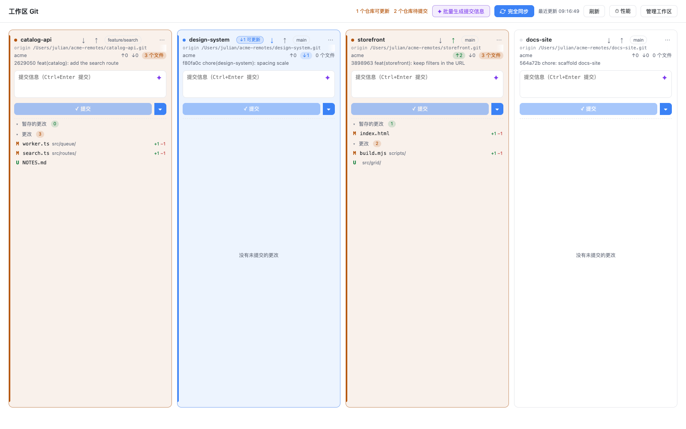

# dsh-workaround-git

DeepSeek Harness (dsh) plugin: batch git operations across every repo in a workspace — one status table, one sync, one commit per repo's own diff, one push.

<p>
  <a href="./LICENSE"></a>
  
  
  
</p>

[简体中文](./README.zh-CN.md)

## Why

Parallel development across a workspace with several projects means the same five git commands, N times, in N terminals. The model can run them one at a time — slowly, with no idea what the other repos are doing, and no single place where the batch result lands.

This plugin gives the model eight verbs that operate on the whole workspace at once, and returns one table per verb: what changed, what moved, what failed and why.

## Screenshots

The panel: one card per repository, with a per-repo commit box, the staged / changes lists, and the batch drafts, one-click sync and workspace management on the toolbar.



## Features

- **Discovery, not configuration.** Every `.git` under the workspace root is a project, and a workspace that points at a subdirectory of a repository is a project scoped to that directory. No repo list to maintain, no config file to drift.
- **One view of everything.** Branch, working-tree dirt, ahead/behind vs upstream, and last commit in a single table.
- **A conflict is a step, not a dead end.** A merge, rebase, cherry-pick or revert in progress is reported with its unmerged files named. Resolve a file in one call (`ours` / `theirs` / mark a hand-edited file resolved), then `continue` or `abort` the operation — a plain commit never concludes a merge behind your back.
- **Only the files you chose.** `git_workspace_commit` can commit exactly what is staged (`stagedOnly`) or an explicit path list per repo, so selective staging actually scopes the commit instead of being cosmetic.
- **Live panel.** The source-control page re-reads `/state` every 10 seconds while visible, refreshes on window focus, and shows `最近更新 HH:MM:SS`, so work done from chat or a terminal shows up without pressing 刷新.
- **Sync that refuses to guess.** Fetches, then fast-forwards; a repo with a dirty working tree is skipped and reported instead of half-resolving a conflict.
- **One commit message per repo.** `git_workspace_changes` hands the model each repo's own diff; `git_workspace_commit` takes a map of repo → message, so a workspace-wide commit never reuses one message.
- **Partial success is normal.** A failed repo is a row in the table, not an aborted batch.
- **Dry run before write.** `sync`, `commit`, and `push` all accept `dryRun`.
- **Zero dependencies, zero build.** Plain ESM, no `npm install` needed to load it.

## Tools

| Tool | What it does | Key arguments |
| --- | --- | --- |
| `git_workspace_status` | Table of every repo: branch, dirt (conflict files named), ahead/behind, last commit, in-progress operation | `root?`, `maxDepth?` |
| `git_workspace_sync` | `fetch` + fast-forward each repo; dirty trees are skipped | `root?`, `maxDepth?`, `mode?`, `dryRun?` |
| `git_workspace_changes` | Per-repo change digest for writing commit messages | `root?`, `maxDepth?` |
| `git_workspace_commit` | Commit repos in one call, each with its own message | `messages` (required), `paths?`, `stagedOnly?`, `root?`, `maxDepth?`, `dryRun?` |
| `git_workspace_push` | Push each repo's branch; sets upstream on first push | `root?`, `maxDepth?`, `dryRun?` |
| `git_workspace_stage` | Stage / unstage named files per repo (`git add`, `git restore --staged`) | `files` (required), `action?`, `root?`, `maxDepth?`, `dryRun?` |
| `git_workspace_restore` | Discard or stash named files per repo; discard needs `confirm: true` | `files` (required), `action`, `confirm?`, `root?`, `maxDepth?`, `dryRun?` |
| `git_workspace_conflicts` | List an in-progress merge/rebase/cherry-pick/revert and its unmerged files; resolve, continue, or abort | `action?`, `repo?`, `paths?`, `confirm?`, `root?`, `maxDepth?`, `dryRun?` |

`root` defaults to the calling session's workspace, then to the process working directory.

## Install

Requires Node `^22.19.0 || >=24.0.0`, dsh `>= 0.2.1-rc.3`, and `git` on `PATH`.

```bash
# from a local checkout (works today)
dsh plugin --profile web add /path/to/dsh-workaround-git

# from GitHub, after the repo is pushed
dsh plugin --profile web add github:Roshenn/dsh-workaround-git#v0.1.0

# from npm, once published
npx -y @deepseek-ai/dsh plugin --profile web add dsh-workaround-git@0.1.0
```

Then restart `dsh web`. `dsh plugin` forwards to pnpm against the profile's `package.json`; the package's `dsh.bundle.patch` mounts `cordis.patch.yml`, which inserts the plugin row.

Verify the row landed:

```bash
dsh --profile web --dump-config | grep workaround-git
```

**Desktop app:** the `desktop` profile is managed by the Electron shell and the CLI refuses it. Open **Plugins → Add plugin** in the app instead.

### Develop against the running desktop app

The desktop app has no working `dsh` CLI shim, so the dev link is the same one
`dsh-looptree-dashboard` uses: a `link:` dependency in the live profile plus a
bundle entry. From the profile directory:

```bash
cd ~/.dsh/profiles/desktop
# package.json:
#   dependencies: "dsh-workaround-git": "link:../../dsh-workaround-git"
#   dsh.profile.bundles: append "dsh-workaround-git"
pnpm install --prefer-offline
```

Then fully quit the app (tray → Quit) and relaunch. The junction
`node_modules/dsh-workaround-git` points at this checkout, so every later edit
is picked up by the next restart — no rebuild step, the client half is plain JS.

Sanity checks before restarting:

```bash
node --test                     # host half
node scripts/smoke-panel.mjs    # panel API end to end against a temp repo
node scripts/bench-panel.mjs    # entry-path timings on the managed workspaces here
node scripts/bench-panel.mjs --breakdown   # same, split per workspace / repo / git command
```

`docs/perf-baseline.md` records what the entry path costs on this machine,
where its `git` spawns go, and the thresholds that decide the next round of
panel-performance work.

## Panel (browser half)

The client half registers a left-sidebar entry (`sidebar.panellist`, order 45)
and a main-area page (`main`). First open lists every workspace dsh knows with
its git state — `git` (the path is inside a work tree: a repo root or a module
directory of one), `contains` (repos live below it), or `none` — and asks which
ones to manage. The choice is stored in
`$DSH_HOME/workaround-git/managed.json`; nothing else is persisted.

A managed workspace is the unit of **management**; the cards are the
**repositories** under it. A workspace classified `contains` expands into one
card per repository, so a card has no workspace row of its own. Use the `⋯`
button in the card header (or right-click the header) and choose 「从面板移除」
to hide a single card: only `hiddenRepos` in `managed.json` changes, never a
repository. Hidden cards stay listed under 「已隐藏的仓库」 in 管理工作区, where
恢复 brings them back.

A managed entry that dsh no longer lists — the workspace was removed from dsh,
or its folder was deleted — stays in the picker with a 「不在 dsh 工作区中」
badge instead of disappearing. Saving the picker merges the selection (existing
entries keep their `addedAt`), accepts an empty list, and reports any entry it
could not add.

A workspace that is a subdirectory of a repository is a **scoped workspace**: its
card shows only that module's branch state, changes and line counts, and commits
from it refuse to run when something outside the module is already staged (the
index is shared with the whole repository). Managing both the repository root and
a module inside it is allowed and yields two cards, one per scope; the same
repository reached twice by different workspaces still renders once.

The workbench is one horizontal strip of vertical cards — one card per
repository, never wrapping to a second row. Four cards are visible on a wide
pane (three, two or one as it narrows); when more repositories are managed the
strip scrolls sideways with the wheel, a trackpad, or the ‹ › buttons that
appear at the edges. Cards fill the pane when fewer than four exist, and the
card body stretches to the pane height. Every card keeps the same block order —
repository header (name, branch, origin URL), commit box, a flexible change
area (min 140px) that fills the leftover height, status line — so the commit
box, the staged section, the changes section and the buttons of a row share one
horizontal line. The strip is the only view — there is no list mode to switch
to, so the cards never reflow into a second layout.

Each card follows VS Code's source-control layout:

- **Remote line** under the repository name: the `origin` URL (falling back to
  the first remote) in small monospace, aligned across cards; a URL that does
  not fit scrolls horizontally on hover and takes no extra height.
- **Commit box** with a model button (✦) that drafts a Conventional Commits
  message from the staged diff; the draft lands in the input and is never
  committed automatically. The split button commits, or commits and pushes.
- **Staged / changes sections** with the per-file status letter, name,
  directory and `+added −removed`; headers collapse and carry stage-all /
  unstage-all.
- **Hover actions** per row: `＋` stages, `−` unstages, `↩` discards after a
  confirmation dialog.
- **Context menu** per file: open file, reveal in the file manager, copy path,
  copy relative path, stage/unstage, add to `.gitignore` (file / extension /
  directory, untracked files only), discard changes…, view diff, file history,
  stash.
- **Card menu** (right-click the header, or the `⋯` button): stage all, unstage
  all, stash all, refresh, copy repo path, reveal repo, remove from panel….
- **Branch menu** in the card header lists local branches and switches with
  `git switch`.
- **Per-repo pull / push**: the `↓` and `↑` buttons left of the branch chip run
  fetch + fast-forward and push respectively; a repo behind its upstream shows
  a blue `↓N 可更新` badge.
- **State colours**: every card carries a state dot and a tinted border /
  background — amber for uncommitted changes, blue for commits to pull, green
  for commits to push, red for conflicts. Count chips (`↑ahead`, `↓behind`,
  files), section count badges and file status letters (M amber, A/U green,
  D red, R violet) reuse the same palette so actionable spots stand out.
- **Batch bar**: 批量生成提交信息 drafts a message for every repository with
  pending changes; the result line reports the drafts and any failures, and each
  draft lands in its card's commit box. Pull and push stay per card (the `↓` / `↑`
  buttons) or across the whole workspace via 完全同步. The buttons render
  enabled in the panel's first frame — the entry path reads the managed store
  first and neither card loading nor the remote check holds them disabled.
- **Full sync**: 完全同步 (a two-arrow cycle icon) chains the whole batch flow behind one click for
  every managed repository — `git fetch`, a model-drafted message plus a commit
  for the pending changes, `git pull --rebase` to integrate the remote, then
  `git push`. It is the bar's only primary (filled) button, because it is the only
  action that pushes without a second click. A repo is skipped — never
  force-handled — when it has no remote, no upstream, an unfinished
  merge/rebase/cherry-pick, or no generated commit message; a conflicting rebase
  stops that repo and leaves it in the conflict lane instead of pushing.
- **Full sync runs in parallel waves**: all repositories `fetch` at once
  and, because the network round trip and the model call are independent, every
  dirty repo drafts and commits while its fetch is still in flight. Rebasing and
  pushing then run as one wave each. A twelve-repo workspace costs roughly the
  slowest repo rather than the sum of twelve, and a remote check that finished in
  the last 15 seconds is reused instead of fetching every repo a second time.
- **Full sync progress**: the header shows a progress bar with
  `已完成/总数 · 当前阶段 · 已用秒数` (the stage names every concurrent stage, e.g.
  `抓取/生成中`), and every card carries a five-dot strip — 抓取 / 生成 / 提交 / 合并
  / 推送 — that marks each stage pending, running, done, skipped or failed, plus
  the per-repo elapsed time once it settles. Card actions are dimmed while its
  repo is in flight, and the hover title names the stage timings in milliseconds.
  The result line reports synced / skipped / failed counts and total seconds.
- **Cards per screen**: 管理工作区 starts with a 显示设置 row whose
  `默认每屏显示项目数` selector picks 1–8 cards (default 4); the choice is
  remembered in `localStorage` (`wg-columns`) and applied immediately, while a
  narrow pane still shows fewer cards rather than shrinking below 260 px.
- **Open terminal**: the `>_` button right of the branch chip launches an
  interactive shell in the repository directory — `wt.exe -d <repo>` when
  Windows Terminal is available, otherwise a hidden PowerShell launcher that
  `Start-Process`es `powershell -NoExit` in that directory (`open -a Terminal`
  on macOS, `x-terminal-emulator` on Linux). The path is passed as the working
  directory or a single argv element, never interpolated into a shell string.
- **Remote update check**: opening the panel runs `git fetch` on every managed
  repository in the background, after the cards render. The header shows a
  spinning 检查远端更新… chip (`role="status"`, no motion under
  `prefers-reduced-motion`) while it runs, and the batch buttons stay clickable
  the whole time; repos behind their upstream then show an amber `↓N 可更新`
  badge plus a header count, and a failed fetch only surfaces a small warning.
  Pressing 刷新 runs the check again.
- **Conflict lane**: a card with an operation in progress shows a badge (合并中 /
  变基中 / 拣选中 / 回滚中) plus 中止… (confirmed, destructive) and 继续 (rebase /
  cherry-pick / revert only, disabled while conflicts remain). A conflict row's
  context menu leads with 用 Ours 解决 / 用 Theirs 解决 — the tooltip notes that
  git inverts them during a rebase — and 标记为已解决; once a merge is fully
  resolved the commit button becomes `✓ 完成合并并提交` and concludes it explicitly.
- **性能 measurement**: the header's 性能 button starts a recording run and
  shows a four-step script in a banner (刷新 → stage a file → type in a commit box →
  open a diff); 结束测量 posts p50/p95 per span — entry path, first card, every
  card action, the poll and the diff drawer — plus long tasks to `/api/perf`, which
  saves `perf-report.json` next to `managed.json` and shows the table in a dialog.
  Nothing is recorded while the button is idle except four entry timestamps per
  mount; `docs/perf-baseline.md` explains what the numbers mean.
- **Live refresh**: the panel re-reads `/state` every 10 seconds while it is
  visible and the batch bar is idle, and immediately (throttled to once per 2 s)
  when the window regains focus or the tab becomes visible. A failed background
  poll stays quiet, a successful one clears a stale error banner, and the header
  shows `最近更新 HH:MM:SS`. A card action cannot start twice, and a poll never
  touches text being typed into a commit box. A card action refreshes only that
  card (`POST /api/repo-state`) instead of re-reading every workspace; `open`,
  `terminal`, `copy` and the card's own 刷新 cannot change git state and skip the
  re-read entirely, falling back to a full `/state` only if the single read fails.
- **Opening and clicking never wait for a full read**: the panel paints the cards
  it painted last (a module-scope snapshot) and the first-ever open shows four
  skeleton cards instead of a blank body, then replaces them when `/state` lands.
  Stage / unstage / stage-all / unstage-all move the file row on the click frame
  and reconcile with `POST /api/repo-state` a moment later; a refused request
  restores the previous row and reads the truth before reporting the error.
- **Diff drawer** (unified patch with line numbers) and **file history** open
  from a row click or the context menu.

Discard is the only destructive action: it asks for confirmation, restores
tracked files with `git restore --worktree`, and deletes untracked files — the
untracked deletion cannot be undone. The model route comes from the session
default (`agentDefaultModel`) or the first advertised provider; no API key ever
reaches the plugin. Drafts run at the cheapest reasoning effort the model
advertises (`low`) rather than the session's effort (typically `max`): a commit
subject is short and format-constrained, so thinking tokens only add latency. A
model that does not advertise `low` keeps the inherited effort — dsh rejects an
explicit unsupported effort instead of clamping it — and an effort the provider
rejects at its endpoint is retried once at the inherited effort, so the draft
never fails on the effort choice alone.

The browser half talks to one prefix route, `/workaround-git/api`:

| Method | Path | Purpose |
| --- | --- | --- |
| GET | `/api/workspaces` | every workspace with its git state (`?refresh=1` bypasses the 60s cache) |
| GET/POST | `/api/managed` | read / merge the managed list (returns `hiddenRepos`) |
| POST | `/api/hidden-repos` | hide or restore one card: `{workspaceId, repo, hidden: true}` / `{path, hidden: false}` |
| GET | `/api/state` | per-repo status with grouped staged / changes / conflicts |
| POST | `/api/repo-state` | one card's state (same row shape as `/api/state`), used to refresh a single card after an action |
| POST | `/api/stage` | stage everything, or the listed `paths` |
| POST | `/api/unstage` | unstage everything, or the listed `paths` |
| POST | `/api/discard` | restore tracked files / delete untracked ones |
| POST | `/api/ignore` | append a rule to the repo's `.gitignore` |
| POST | `/api/fetch` | fetch every managed repo (or one) and report per-repo failures |
| POST | `/api/batch` | pull / push / suggest / stage-and-commit across every managed repo |
| POST | `/api/perf` | save one panel measurement as `$DSH_HOME/workaround-git/perf-report.json` (diagnostics; never touches a repository) |
| POST | `/api/autosync` | start a full sync; returns `{ jobId, total, reusedFetch }` immediately |
| GET | `/api/autosync/<id>` | per-repo, per-stage progress for that job (poll it) |
| POST | `/api/open` | open a file, or reveal it in the file manager |
| POST | `/api/terminal` | open an interactive terminal at the repository directory |
| POST | `/api/diff` | unified diff for one file |
| POST | `/api/history` | commits that touched a file |
| POST | `/api/stash` | stash the listed paths |
| POST | `/api/branches`, `/api/branch-switch` | list / switch local branches |
| POST | `/api/suggest` | model-drafted commit message (no commit) |
| POST | `/api/commit` | commit the message in the box (`allowSequencer: true` concludes a resolved merge) |
| POST | `/api/resolve` | resolve one conflicted file: `strategy: ours \| theirs \| stage` |
| POST | `/api/sequencer` | `action: continue \| abort` for the in-progress merge/rebase/cherry-pick/revert |
| POST | `/api/sync`, `/api/push` | per-repo sync / push |

Mutations take `{workspaceId, repo}`; every `path` must resolve inside that
repository, so the browser cannot turn the panel into "run git anywhere". A
scoped workspace additionally pins every command to its module directory, and a
commit is refused (`scope-conflict`) when the shared index holds changes staged
outside that module.

## Configure

Defaults live in `cordis.patch.yml` and can be edited there:

| Field | Default | Meaning |
| --- | --- | --- |
| `maxDepth` | `3` | How deep to descend under the root looking for `.git` |
| `concurrency` | `4` | Repos processed in parallel |
| `pullMode` | `ff-only` | Default integration for `git_workspace_sync`: `ff-only`, `rebase`, or `merge` |
| `allowOutsideRoot` | `false` | Allow a `root` outside the session workspace (see [Safety boundaries](#safety-boundaries)) |

The patch loader replaces `config` wholesale, never deep-merges — restate every field you need.

## Usage

You do not call the tools yourself; you ask in chat and the model picks them.

**Where am I?**
> What do the repos in this workspace look like right now?

**Catch up before starting work:**
> Sync everything that is safe to sync, then tell me which repos were skipped and why.

**The two-step commit:**
> Look at what changed in each repo, write a commit message per repo from its own diff, then commit.

The model calls `git_workspace_changes`, reads each repo's files and line counts, writes one message per repo, and passes them back as a map:

```json
{
  "messages": {
    "api-server": "fix(auth): refresh token before expiry instead of after",
    "web-client": "feat(settings): move account section above billing"
  }
}
```

A repo with no entry in `messages` is skipped — never committed with someone else's message. Keys must be the exact label shown by `git_workspace_changes` (or an absolute path); a bare directory name is not enough once labels nest (`apps/api-server` and `libs/api-server` both end in `api-server`), and an unmatched key fails the call instead of being dropped.

**Push the batch:**
> Push every repo you just committed.

**Get out of a conflicted update:**
> Three repos stopped on a merge conflict. List the unmerged files, take the incoming side in each, then finish the merges.

`git_workspace_conflicts` reports the operation and its files, `action: "theirs"` resolves and stages them, and `action: "continue"` concludes the merge. `action: "abort"` throws the operation away and needs `confirm: true`.

**Commit only part of a repo:**
> Stage just the README and src/auth.js in api-server, then commit those and leave my other changes alone.

`git_workspace_stage` puts those paths in the index, and `git_workspace_commit` with `stagedOnly: true` (or a `paths` map) commits exactly them.

## Example output

`git_workspace_sync` on a five-repo workspace, dry run — it fetches so the preview is accurate, then stops before integrating:

```
**sync** · 5 repos · up-to-date: 3, would-sync: 1, skipped: 1

| repo | action | status | after | detail |
| --- | --- | --- | --- | --- |
| app | up-to-date | ok | ↑0 ↓0 | already up to date |
| app-ahead | up-to-date | ok | ↑1 ↓0 | already up to date |
| app-behind | would-sync | ok | ↑0 ↓1 | — |
| app-dirty | skipped | skipped | ↑0 ↓0 | working tree is dirty (0 staged, 1 modified, 1 untracked) |
| app-nested/deep | up-to-date | ok | ↑0 ↓0 | already up to date |
```

## What it will not do

- **No force push, no `reset --hard`, no history rewrite on its own.** Sync fetches, then integrates with `--ff-only` unless you ask for `mode: 'rebase'` or `'merge'`; `push` is a plain `git push`.
- **No commit without a message.** `messages` is required, every value must be a non-empty string, and a key that matches no repo label is reported as an error rather than silently ignored.
- **No syncing a dirty repo.** A repo with staged, modified, untracked, or conflicted files is skipped with the reason, because a conflict resolved wrongly in ten repos at once is worse than one repo left for you. A skip is reported, not counted as a failure.
- **No bare repos.** Discovery looks for a `.git` directory or worktree file; bare remotes on disk are ignored, and `node_modules`, `dist`, `build`, `target`, `.venv`, and dot-directories are skipped. Submodules do carry a `.git` file, so they show up as their own repos.
- **No silent partial staging.** `git_workspace_commit` stages everything (`git add --all`) by default; `stagedOnly: true` commits exactly the index, and a per-repo `paths` map stages and commits only those files (`git commit --only`), leaving other staged work in place.
- **No silent merge conclusion.** A repo with an operation in progress is refused by `git_workspace_commit`; the merge/rebase is finished through `git_workspace_conflicts` (`continue`) or the panel's explicit `完成合并并提交`.
- **No credentials handling.** Authentication is whatever your `git` already has configured; `GIT_TERMINAL_PROMPT` is disabled so a missing credential fails fast instead of hanging.

### Safety boundaries

`root` is model-generated, and every operation runs `git` in that directory. It is therefore confined to the calling session's workspace: a `root` outside it is refused before any `git` process starts. A deliberate wider scan requires `allowOutsideRoot: true` in the plugin config.

Reads (`status`, `changes`) never write. `sync`, `commit`, and `push` accept `dryRun`; the sync preview still fetches, because a preview that cannot see upstream commits would report the wrong thing — it never integrates, resets, or writes to a working tree.

## How it works

```
lib/index.js    cordis plugin: exports name / inject / apply, registers eight tools
lib/git.mjs     git primitives: discovery, status, sync, changes, commit, push
lib/format.mjs  markdown rendering of each batch result
```

Discovery walks the root depth-first to `maxDepth`, treating every directory with a `.git` entry as a project, and keeps walking inside it (worktrees, nested projects); a hard cap of 200 repos stops a wrong root from turning into an unbounded scan. Status is parsed from `git status --porcelain=v2 --branch`, so ahead/behind come from the repo's own view of its upstream.

Every per-repo operation resolves with a result object and never rejects: the plugin reports partial failure instead of throwing away the whole batch.

## Development

```bash
node --test                                # 79 tests against real git repos in a temp workspace
node scripts/smoke.mjs                     # print the status table, a sync dry run, and the change digest

# optional: prove the schemas compile under the real tool registry, not the test stub
npm i --no-save @deepseek-ai/dsh-tools && node scripts/validate-schema.mjs
```

No install step: there are no runtime dependencies. `@deepseek-ai/dsh-tools` and `@deepseek-ai/cordis` are peer dependencies supplied by the harness; the plugin test stubs the former through a loader hook.

## Compatibility

| | |
| --- | --- |
| dsh | `>= 0.2.1-rc.3` |
| Node.js | `^22.19.0 \|\| >=24.0.0` |
| Platforms | Windows, macOS, Linux (anywhere `git` runs) |
| Host kind | host tools + browser panel (`dsh.client` entry, plain JS, no build) |

## License

[MIT](./LICENSE)
